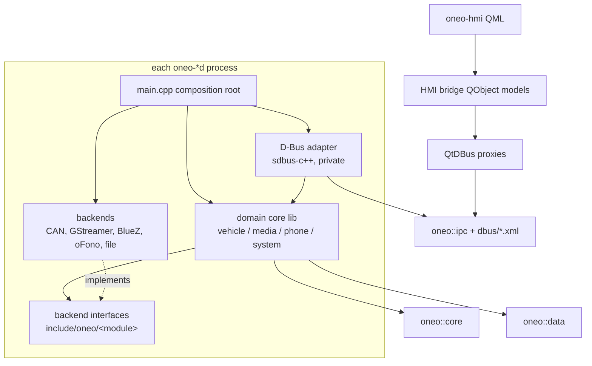

# One-O C++ Software Architecture (R1)

Owner: cpp-architect. Inputs: [system.md](system.md), ADR-001..005, requirements.md. Ticket: T-008.
Public API: `include/oneo/` (pure interfaces + value types, platform-neutral C++17). D-Bus contracts: `include/oneo/dbus/*.xml`.

## 1. Modules

| Module | Headers | Content | Owner role (impl) | REQ |
|---|---|---|---|---|
| core | `core/error.hpp`, `result.hpp`, `subscription.hpp`, `event_loop.hpp`, `service.hpp`, `lockout.hpp` | ErrorCode/Error, Result<T>, Completion<T>, RAII Subscription, IEventLoop/IClock, ILogger, IServiceRuntime, IComponent, ILockoutSource | core-logic-engineer | REQ-005, 007, 304, 408 |
| ipc | `ipc/bus_names.hpp`, `dbus/*.xml` | bus names/paths, error-name mapping, introspection XML (source of truth) | middleware-engineer | REQ-022, 203, 406 |
| data | `data/key_value_store.hpp`, `data/media_index.hpp` | atomic debounced settings store, USB media index | data-engineer | REQ-030, 108, 109 |
| vehicle | `vehicle/types.hpp`, `vehicle_signals.hpp`, `backend.hpp` | SignalId/Sample/Spec, IVehicleSignals, IVehicleBackend, ICanChannel | domain-engineer, middleware-engineer | REQ-020, 021, 024, 025, 027, 200-203, 407 |
| media | `media/types.hpp`, `media_service.hpp`, `backends.hpp` | IMediaService, IPlaybackEngine, IBluetoothAudio, IUsbWatcher | middleware-engineer | REQ-029-037, 205, 207, 306 |
| phone | `phone/types.hpp`, `phone_service.hpp`, `bluetooth.hpp` | IPhoneService, IBluetoothAdapter, IHandsFree, IPhonebookClient | middleware-engineer | REQ-038-047, 401, 406 |
| system | `system/types.hpp`, `system_service.hpp` | ISystemService, ILockoutPolicy, setting keys, health/versions | core-logic-engineer | REQ-007, 009, 016-018, 037, 048-050 |
| adapters (private) | `src/<svc>/dbus/` | sdbus-c++ adaptors/proxies generated from XML; map Result errors to `org.oneo.Error.*` | middleware-engineer | ADR-002 |
| HMI bridge (private) | `hmi/bridge/` | QtDBus proxies (generated from same XML) wrapped in QObject models for QML; Qt-only, so not in `include/` | qt-qml-engineer, app-engineer | REQ-014, 022, 024 |

## 2. Dependency rules

| Rule | Enforced by |
|---|---|
| `core` depends on the C++17 standard library only. | CMake target deps |
| `data` -> `core` (+ `media/types.hpp` value types). Domain cores -> `core`, `data`, own module headers. | CMake |
| Domain modules never depend on each other; cross-service data goes over D-Bus (e.g. system reads VehicleSpeed via proxy). | review, CMake |
| Lockout (REQ-408): oneo-system is the only lockout authority. Vehicle and phone cores get it only through an injected `core::ILockoutSource`; the target impl (in the adapter layer) is backed by the org.oneo.System `DrivingLocked` proxy and reports locked until the first value arrives and whenever org.oneo.System leaves the bus. vehicled (all SetSetting), phoned (StartDiscovery, Pair, ConfirmPairing, RemoveDevice) and oneo-system (keys where `system::lockedWhileDriving(key)`) reject with `DrivingLocked`, independent of the caller. | unit tests (negative, REQ-408), review |
| Domain cores: no Qt, no D-Bus, no Linux headers (REQ-304). Only `src/**/linux/` and adapters may include `<linux/can.h>`, sdbus-c++, gstreamer, systemd. | CMake `if(UNIX AND NOT APPLE)`, clang-tidy include check |
| HMI depends only on generated QtDBus proxies + `ipc/bus_names.hpp`; never on domain headers, CAN, BlueZ or PipeWire (REQ-022). | CMake |
| Public headers: pure interfaces (`I*`, virtual dtor, no data members) or value types; no implementation beyond trivial inline helpers. | review |
| XML in `include/oneo/dbus/` is the contract; changing it requires bumping `Version` for breaking changes and regenerating both sides. | CI codegen diff |

## 3. Daemon skeleton (ADR-004)

| Step | Action |
|---|---|
| 1 | Parse args (`--backend=mock|can`), create ILogger, IServiceRuntime, IEventLoop. |
| 2 | Construct backends -> core -> adapter (unique_ptr, owned by main). |
| 3 | `start()` each IComponent in that order; on error log + exit non-zero (systemd restarts). |
| 4 | Request bus name, publish initial properties, `notifyReady()`; periodic timer pings watchdog at interval/2. |
| 5 | SIGTERM -> `notifyStopping()`, `stop()` in reverse order, flush store, exit 0. |

## 4. Threading / event-loop model

| Rule | Detail |
|---|---|
| One loop thread per daemon | sd-event (via sdbus-c++) on target; manual/fake loop in host tests. D-Bus dispatch, timers, CAN socket, backend callbacks all run on it. |
| Thread confinement | Core objects are not thread-safe and are only touched on the loop thread (`isLoopThread()` asserts in debug). No mutexes in domain logic. |
| Workers | Blocking/long work (media scan, tag parsing, PBAP parse, fsync) runs on impl-owned worker threads; results return via `IEventLoop::post()`. Only `post()` and `ILogger::log()` are thread-safe. |
| Callbacks | Observers and `Completion<T>` are invoked on the loop thread, never inline from the call that registered/started them, exactly once for Completions (Cancelled on stop). |
| Non-blocking API | Core methods never block; anything waiting on a device or the vehicle is async (`Completion`). Adapters use async D-Bus replies. |
| Latency | Watchdog 2 s, PropertiesChanged coalesced 50 ms, vehicle path budget 200 ms (REQ-024). Handlers must return in < 10 ms. |
| HMI | Qt GUI thread owns QtDBus proxies; all D-Bus calls async (`QDBusPendingCallWatcher`); no blocking calls on GUI thread. |

## 5. Memory ownership

| Rule | Detail |
|---|---|
| Composition root owns | `main()` holds every component in `std::unique_ptr`; destruction in reverse construction order. No globals/singletons. |
| Dependencies by reference | Constructors take `IFoo&` references to collaborators that outlive them (constructor injection). No ownership transfer through interfaces. |
| No raw new/delete | `std::make_unique`; `shared_ptr` only where a worker may outlive the request (e.g. cancellation token), documented at the site. |
| Subscriptions | Observer lifetime is bounded by the returned `core::Subscription`; it must be destroyed before the observer and before the source. |
| Values | Value types are copied/moved; interfaces return by value or `Result<T>`; no references/pointers into internal containers. |
| Bounded memory | Caches have fixed caps (5 devices, contact/log limits, browse paging) to keep REQ-104/106 budgets; no unbounded queues (post queue warns > 1000). |

## 6. Error handling

| Rule | Detail |
|---|---|
| Expected failures | Returned as `core::Result<T>` / `Completion<T>` carrying `core::Error{code, message}`. `[[nodiscard]]` enforced. |
| Exceptions | Not thrown across module or D-Bus boundaries. Third-party exceptions (sdbus-c++, std) are caught in adapters/backends and converted to `Error`. `std::bad_alloc` and logic bugs terminate -> systemd restart + coredump (REQ-006). |
| D-Bus mapping | `ErrorCode::X` <-> `org.oneo.Error.X` (`ipc::dbusErrorName`). Message is diagnostic only, never shown to users; HMI maps codes to translated strings (REQ-019, REQ-028). |
| Fail-safe defaults | Unknown/invalid vehicle data -> `valid=false`; invalid speed -> `DrivingLocked=true` (REQ-050); lockout unknown (System absent / no value yet) -> locked (REQ-408); corrupt settings -> last good copy or defaults. |
| Logging | Every Error that leaves a core component is logged once at the adapter with component + code; rate-limited (REQ-108). |
| Asserts | `assert` for invariants in debug; release builds keep checks that guard external input. |

## 7. D-Bus contracts (`include/oneo/dbus/`)

| File | Bus name / path | State (properties) | Commands (methods) | Signals |
|---|---|---|---|---|
| org.oneo.VehicleSignals.xml | org.oneo.VehicleSignals, /org/oneo/VehicleSignals | 11 signals as `(vbt)` = value, valid, timestamp_us | GetAll, SetSetting(s,i) (deferred reply until feedback/timeout) | PropertiesChanged |
| org.oneo.Media.xml | org.oneo.Media, /org/oneo/Media | Source, AvailableSources, PlaybackState, Track, PositionMs, Volume, LibraryScanning, LibraryTrackCount | Play/Pause/Next/Previous, SetSource, SetVolume, Browse, PlayItem | LibraryChanged |
| org.oneo.Phone.xml | org.oneo.Phone, /org/oneo/Phone | Devices, PairingState, Calls, ContactCount | Start/StopDiscovery, Pair, ConfirmPairing, RemoveDevice, Connect, Dial, Answer, Reject, Hangup, SearchContacts, GetCallLog | PairingConfirmationRequested, ContactsSynced |
| org.oneo.System.xml | org.oneo.System, /org/oneo/System | DrivingLocked, LockoutThresholdKph, Locale, Units, ThemeMode, Theme, Faulted | Get/SetSetting(s,v), GetHealth, GetVersions, ReportFault | SettingChanged, HealthChanged |

All interfaces carry a const `Version` property (= `ipc::kInterfaceVersion`). Setting keys: `hmi.locale`, `hmi.units`, `hmi.themeMode`, `safety.lockoutKph`, `media.volume`, `media.lastSource`, `phone.lastDevice` (`system/types.hpp`). mediad persists volume/last source through org.oneo.System (single settings owner, ADR-004).

## 8. CMake target layout

| Target | Type | Sources | Links | Built on |
|---|---|---|---|---|
| `oneo_api` | INTERFACE | `include/` | - | all |
| `oneo_core` | STATIC | `src/core/` (Result helpers, ManualEventLoop, stderr logger) | oneo_api | all |
| `oneo_data` | STATIC | `src/data/` (atomic KV store, media index) | oneo_core | all |
| `oneo_vehicle_core`, `oneo_media_core`, `oneo_phone_core`, `oneo_system_core` | STATIC | `src/<svc>/core/` | oneo_core, oneo_data | all |
| `oneo_vehicle_mock`, `oneo_*_fakes` | STATIC | `src/<svc>/mock/`, `tests/fakes/` | `<svc>_core` | all |
| `oneo_vehicle_can`, `oneo_media_gst`, `oneo_phone_bluez`, `oneo_systemd_runtime` | STATIC | `src/<svc>/linux/` | `<svc>_core`, system libs | `if(UNIX AND NOT APPLE)` |
| `oneo_<svc>_dbus` | STATIC | `src/<svc>/dbus/` + generated adaptor from XML | `<svc>_core`, sdbus-c++ | `if(UNIX AND NOT APPLE)` |
| `oneo-vehicled`, `oneo-mediad`, `oneo-phoned`, `oneo-system` | EXECUTABLE | `src/<svc>/main.cpp` | core + linux + dbus targets | `if(UNIX AND NOT APPLE)` |
| `oneo-hmi` | EXECUTABLE | `hmi/` (QML, bridge, generated QtDBus proxies) | Qt6::Quick, Qt6::DBus | Qt found + Linux |
| `oneo_tests` | EXECUTABLE (CTest) | `tests/unit/` | `*_core`, mocks/fakes, GoogleTest | all (Windows host, REQ-055) |

| Setting | Value |
|---|---|
| Language | `CMAKE_CXX_STANDARD 17`, `CMAKE_CXX_STANDARD_REQUIRED ON`, `CMAKE_CXX_EXTENSIONS OFF` |
| Warnings | `oneo_warnings` INTERFACE target linked by every target (coding.md): `-Wall -Wextra -Wpedantic -Wshadow -Wconversion -Wsign-conversion -Wnon-virtual-dtor -Wold-style-cast -Woverloaded-virtual`; `-Werror` when `ONEO_WERROR=ON` (CI) |
| Options | `ONEO_VEHICLE_BACKEND=mock|can` (default mock on host), `ONEO_BUILD_HMI=ON|OFF`, `ONEO_WERROR=ON|OFF` |
| GoogleTest (host) | `FetchContent_Declare(googletest GIT_TAG v1.15.2)` pinned tag (needs git, which the portable toolset has); `FETCHCONTENT_TRY_FIND_PACKAGE_MODE` lets Yocto/CI use a system GTest instead. No other host deps. |
| Transition | The current root `CMakeLists.txt` (single target from `one-o/src/main.cpp`) is a placeholder and gets replaced by this layout in Phase 3 (app-lead). |

## 9. Open points
- DBC (D-06): SignalId set and value encodings are provisional until the OEM DBC lands; the enum is append-only.
- SetSetting confirmation timeout default 1 s; tune with real ECU response times.
- Theme auto mode uses `AmbientDark`; headlight fallback rule to be confirmed by ux-lead.
