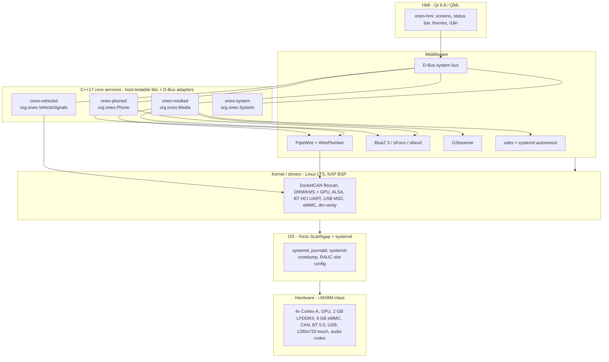
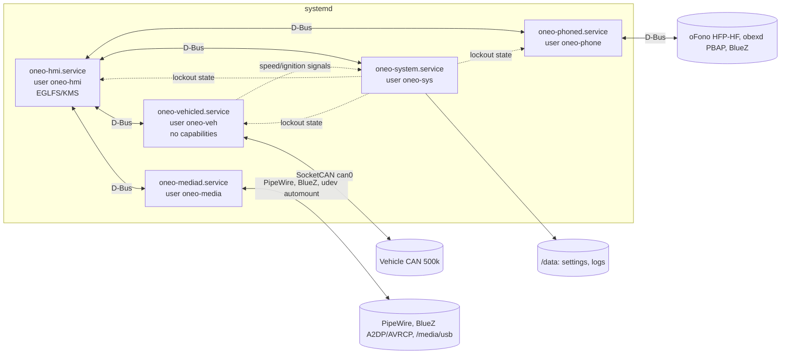
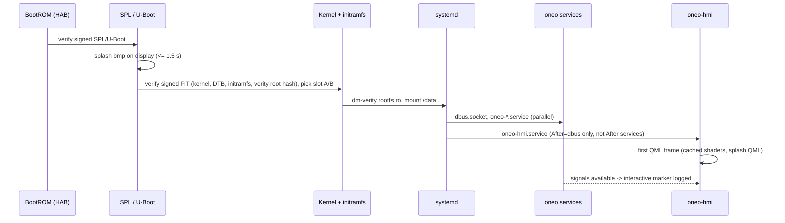

# One-O System Architecture (R1)

Owner: principal-architect. Inputs: docs/requirements/requirements.md, docs/product/decisions.md (all D-xx are ASSUMPTIONs; architecture follows the defaults).
Decisions: [ADR-001](adr/ADR-001-platform-baseline.md) platform, [ADR-002](adr/ADR-002-ipc-dbus.md) IPC, [ADR-003](adr/ADR-003-audio-bt-stack.md) audio/BT, [ADR-004](adr/ADR-004-process-model-supervision.md) process model, [ADR-005](adr/ADR-005-secure-boot-update.md) boot security/update.

## 1. Layers

Rule: HMI talks only D-Bus to `org.oneo.*` services; no CAN/BlueZ/PipeWire access from UI (REQ-022). Every service = pure C++17 core library (no Qt, no D-Bus) + thin adapter, so logic runs on host with mocks (REQ-055, REQ-304).

## 2. Process model

| Process | Unit / user | Restart policy | D-Bus name |
|---|---|---|---|
| oneo-hmi | oneo-hmi.service / oneo-hmi | Restart=always, RestartSec=200ms, WatchdogSec=2s | (client only) |
| oneo-vehicled | Type=notify / oneo-veh | same | org.oneo.VehicleSignals |
| oneo-mediad | Type=notify / oneo-media | same | org.oneo.Media |
| oneo-phoned | Type=notify / oneo-phone | same | org.oneo.Phone |
| oneo-system | Type=notify / oneo-sys | same | org.oneo.System |

All: StartLimitBurst=5 / StartLimitIntervalSec=60 then OnFailure=oneo-fault@.service (REQ-007). Details in ADR-004.

## 3. Components, owners, traceability

| Component | Layer | Responsibility | Owner role | REQ |
|---|---|---|---|---|
| BSP / machine conf | L1-L3 | i.MX8M machine, DT, flexcan, BT UART, codec, display, touch | yocto-bsp-lead, kernel-engineer, hw-integration-engineer | REQ-300, 200, 204, 206, 207, 410 |
| Image + recipes | L2 | meta-oneo layer, oneo-app recipe, reproducible build, image manifest | yocto-build-engineer | REQ-001, 002, 003, 301 |
| Partitions / boot chain | L2 | A/B rootfs, /data, HAB, dm-verity, RAUC slots | yocto-bsp-lead, security-engineer | REQ-052, 053, 208, 403, 404, 109, 410 |
| System config | L2 | systemd units, users, journald rotation, coredump, sysctl hardening | linux-systems-engineer | REQ-005-008, 051, 108, 406, 409 |
| Boot-time instrumentation | L2/L6 | boot markers, CI boot log | perf-engineer, linux-systems-engineer | REQ-004, 100, 101 |
| oneo-vehicled | L5 | DBC decode/encode, signal cache, validity timeouts, write allow-list, mock/real backend | domain-engineer, middleware-engineer | REQ-020, 021, 024, 025, 027, 200-203, 407, 408 |
| oneo-mediad | L5 | USB scan/index, playback (GStreamer to PipeWire), BT A2DP/AVRCP, source switch, volume | middleware-engineer, data-engineer | REQ-029-037, 205, 207, 306, 409 |
| oneo-phoned | L5 | pairing (SSP numeric), 5 devices, reconnect, HFP calls, PBAP sync, contact search | middleware-engineer | REQ-038-043, 046, 047, 204, 401, 406, 408 |
| Audio policy | L4 | WirePlumber roles: alert > call > prompt > media, -20 dB duck, call pause/resume | middleware-engineer | REQ-044, 045, 205, 402 |
| oneo-system | L5 | settings store (atomic), locale/units/theme state, driver-distraction lockout, health/versions | core-logic-engineer, data-engineer | REQ-009, 016-018, 037, 048-050, 108, 109, 408 |
| oneo-hmi | L6 | home, status bar, now-playing, phone, settings, diagnostics; themes; i18n catalogues | qt-qml-engineer, app-engineer | REQ-010-015, 017-019, 023, 026, 028, 030, 034, 035, 042, 102, 103 |
| Interfaces / headers | L5 | C++ interfaces + D-Bus XML contracts | cpp-architect | REQ-020, 022, 304 |
| Test harness | all | host CTest with mocks, HIL soak | qa-lead, unit-test-engineer, integration-test-engineer | REQ-055-057, 105, 106 |
| Security | all | threat model, hardening review | security-engineer | REQ-051, 054, 405, 406 |

## 4. Boot sequence vs REQ-100 / REQ-101

| Stage | Budget (cum.) | Notes |
|---|---|---|
| ROM + SPL + U-Boot, splash shown | 1.5 s | U-Boot splash satisfies "splash <= 3 s" with margin; bootdelay=0 |
| Kernel + initramfs + verity | 3.0 s | Trimmed config, built-in drivers for boot path, quiet |
| systemd to dbus + /data | 4.0 s | Minimal unit set, no getty/network-wait in boot path |
| Services ready (notify) | 5.0 s | Parallel; HMI does not wait for them |
| HMI first frame | 6.5 s | Qt Quick compiler, shader cache, lazy-loaded screens |
| Interactive HMI | <= 7.5 s | Margin 2.5 s vs REQ-100 (10 s) |
| Warm/resume (suspend-to-RAM) | <= 3 s | HMI stays resident; REQ-101 |
| Crash recovery | 0.2 s restart + HMI start | REQ-005 (2 s), REQ-107 |

Measurement (REQ-004): oneo-hmi writes `ONEO_BOOT_INTERACTIVE` with CLOCK_BOOTTIME to journal on first input-ready frame; CI stores it with `systemd-analyze` output per build.

## 5. Storage and update path

| Partition | Content | Mode |
|---|---|---|
| eMMC boot0/boot1 | SPL + ATF + U-Boot (`imx-boot`), redundant copy | ro (HAB-verified) |
| env_a / env_b (raw, 2x 128 KB) | redundant U-Boot env: bootslot, bootcount | rw |
| fit_a / fit_b (2x 32 MB) | signed FIT per slot: kernel, DTB, initramfs, verity root hash. Outside verity, because U-Boot reads it before verity is set up | ro |
| rootfs_a / rootfs_b (2x 2 GB) | ext4 rootfs (<= ~1.9 GB content) + verity hash tree (~32 MB) in the same slot, `rootfs-version` | ro (dm-verity) |
| data (~3.1-3.2 GiB, estimate, verify on board) | settings, logs, BT pairings, media index | rw ext4, journalled, `noexec,nosuid,nodev`, atomic write-rename |

Detail: docs/platform/yocto.md section 4. Update (R1): a signed RAUC bundle writes fit_x and rootfs_x of the inactive slot together (via USB/service tool), with U-Boot boot-count fallback (`bootlimit=3`). No OTA client or backend (REQ-208, D-05); OTA added in R3 on the same slots.

## 6. Open points
- All D-xx are customer ASSUMPTIONs; D-06 (DBC), D-07 (SoC), D-11 (HAB availability) most affect this architecture.
- Memory budget (REQ-104) per process to be set by perf-engineer; initial split: hmi 220 MB, services 4x 30 MB, middleware 100 MB, OS 70 MB.
