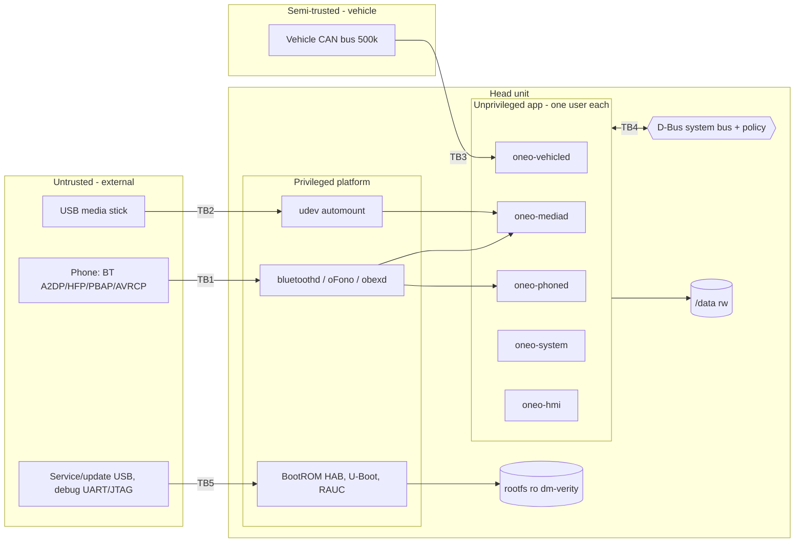

# One-O Threat Model (R1)

Owner: security-engineer. Inputs: system.md, ADR-002/004/005, requirements.md. Satisfies REQ-054 (model); the security test pass is a Verify-phase task (section 7). All D-xx are ASSUMPTIONs.

## 1. Assets

| ID | Asset | Why it matters |
|---|---|---|
| A1 | Vehicle CAN bus integrity (write path: lighting, units, climate) | Safety / vehicle misbehaviour |
| A2 | Image integrity (SPL, U-Boot, FIT, rootfs) and signing keys | Persistent compromise |
| A3 | Phone data: BT bonds/link keys, contacts, call log (/data) | Privacy |
| A4 | Driver-distraction lockout state and speed signal | Safety (REQ-048..050) |
| A5 | Audio priority (safety alerts) | Safety (REQ-402) |
| A6 | Service availability (HMI, supervisors) | REQ-005, 105 |
| A7 | Settings, logs | Integrity, eMMC wear |

## 2. Trust boundaries

| TB | Boundary | Crossing data |
|---|---|---|
| TB1 | Phone to BlueZ/oFono/obexd | Pairing, audio, AT/HFP, vCards, metadata |
| TB2 | USB stick to udev/mediad | Filesystem, files, tags, codecs |
| TB3 | CAN to vehicled | Frames in; allow-listed writes out |
| TB4 | App processes via D-Bus | Method calls, signals |
| TB5 | Physical/service ports to boot chain | Update bundles, console, JTAG |

## 3. STRIDE threats and mitigations

Likelihood/Impact: L/M/H. Component names per system.md.

| ID | Boundary | STRIDE | Threat | L/I | Mitigation | Component | REQ |
|---|---|---|---|---|---|---|---|
| T-01 | TB3 | T | Rogue CAN node spoofs speed/ignition to defeat or force lockout | M/H | Plausibility and rate checks; missing speed = driving (locked); validity timeouts | oneo-vehicled, oneo-system | REQ-025, 050 |
| T-02 | TB3 | T/E | Compromised app or D-Bus caller sends arbitrary CAN writes | M/H | Write allow-list in vehicled only; only vehicled has can0 access; value range checks; feedback confirmation; no raw-frame D-Bus method | oneo-vehicled | REQ-407, 027, 022 |
| T-03 | TB3 | D | CAN flood starves vehicled | M/M | Kernel rx filters on needed IDs only; bounded queues; watchdog restart | oneo-vehicled | REQ-005, 025 |
| T-04 | TB1 | S | Pairing MITM / unsolicited pairing | M/M | SSP numeric comparison; no Just Works; pairing disabled while driving; discoverable only in pairing UI with timeout | oneo-phoned, BlueZ | REQ-038, 401, 406 |
| T-05 | TB1 | I | Contacts/link keys leaked via /data or logs | M/M | Bonds and PBAP cache in 0700 service dir (ReadWritePaths); no PII in logs; wipe on unpair/factory reset | oneo-phoned, oneo-system | REQ-039, 046, 051 |
| T-06 | TB1 | T/E | Malformed BT/vCard/AVRCP metadata exploits parser | M/H | Non-root unprivileged parsers, bounded lengths, fuzzing, keep BlueZ/oFono patched, sandboxed units | oneo-phoned, oneo-mediad | REQ-051, 405 |
| T-07 | TB1 | S | Phone invokes HMI actions via AVRCP/HFP beyond allowed (e.g. dial, volume abuse) | L/M | Accept only profile-defined commands; volume clamped; alerts never muted | oneo-mediad, audio policy | REQ-033, 402 |
| T-08 | TB2 | T/E | Malicious USB: exploit via filesystem, tags, codecs; HID/BadUSB device | M/H | Mount ro, nosuid,nodev,noexec; limit FS types (vfat, exfat, ext4 off); USB class allow-list (MSC only), disable other classes; decode in unprivileged mediad with Protect* hardening; bounded index | udev, oneo-mediad | REQ-409, 207, 031, 406 |
| T-09 | TB2 | D | Huge/looping media tree exhausts CPU/RAM/eMMC | M/L | Scan depth/file-count limits; index in memory or capped file; cgroup MemoryMax/CPUQuota | oneo-mediad | REQ-104, 108 |
| T-10 | TB4 | S/E | Process impersonates an org.oneo.* name or calls methods it should not | M/H | D-Bus policy: only named user may own each name; per-method send rules (HMI only calls what UI needs); deny default | dbus policy, all | REQ-406, 022 |
| T-11 | TB4 | T | HMI (largest attack surface, Qt) used to bypass lockout | M/H | Lockout enforced in services, not only in UI: oneo-phoned rejects pairing, oneo-system rejects settings edits, oneo-vehicled rejects vehicle write commands while locked. Unknown state = locked; oneo-system is the only lockout authority | oneo-system, oneo-phoned, oneo-vehicled | REQ-408, 048, 401 |
| T-12 | TB4 | D | Malicious/buggy client floods D-Bus | L/M | Signal rate limits, bus message/connection limits, restart policy and StartLimit | dbus, systemd | REQ-005, 007 |
| T-13 | TB5 | T/E | Tampered or downgraded update bundle | M/H | RAUC signed bundles (X.509), verify before write; reject lower version; A/B + boot-count fallback | RAUC, U-Boot | REQ-052, 208, 404 |
| T-14 | TB5 | T | Modified boot chain / rootfs / offline tampering | L/H | HAB-closed SPL/U-Boot; signed FIT; dm-verity root hash in FIT; U-Boot env not trusted for boot args (args in FIT or locked). Note: the FIT sits on raw fit_a/fit_b partitions outside verity, so only its signature protects it | BootROM, U-Boot, kernel | REQ-052, 053, 403 |
| T-15 | TB5 | E/I | Debug UART/JTAG/USB-gadget gives root | H/H | Production: JTAG fused off, serial login disabled, bootdelay=0, U-Boot console off, no root password, no adb/dropbear, USB gadget off | BSP, U-Boot | REQ-410, 406, 052 |
| T-16 | TB5 | I | Dev signing keys or dev image reaches production | M/H | Dev keys only in dev images; release gate checks HAB-closed, verity on, prod key fingerprint; keys in HSM | CI, release | REQ-403, 405 |
| T-17 | all | E | Service compromise escalates to root/kernel | M/H | Non-root per-service users, NoNewPrivileges, ProtectSystem=strict, PrivateTmp, no capabilities, SystemCallFilter, rootfs ro | systemd units | REQ-051 |
| T-18 | /data | T/D | Power loss or tampering corrupts settings/bonds | M/M | Atomic write-rename, journalled ext4, /data mounted nosuid,nodev,noexec | oneo-system | REQ-109 |
| T-19 | all | R | No trace of security events | M/L | journald persistent, rotated; log pairing, update, USB mount, policy denials, crash reasons | linux-systems | REQ-006, 008 |
| T-20 | all | I | Unneeded network exposure (no IP service in R1) | L/M | No listening TCP/UDP ports in image; no WiFi/ethernet daemons; firewall default-drop if net enabled later | image | REQ-406 |

## 4. Residual risks

| ID | Risk | Status | Owner / action |
|---|---|---|---|
| R-01 (REQ-404) | **No-HAB gap**: if SoC fuses/HAB are unavailable (D-11 unconfirmed), boot chain (T-14) is unauthenticated; attacker with physical access can replace SPL/U-Boot/FIT. Only update-time RAUC signature verification (T-13) applies. | Open, accepted conditionally | Compensating: RAUC signature check at install, dm-verity disabled cannot be assumed, U-Boot env locked, debug ports closed, anti-downgrade. Re-assess when D-11 resolved; yocto-bsp-lead to confirm HAB availability. Release gate: gap shown in release notes. |
| R-02 | Vehicle CAN is unauthenticated by design | Accepted | Mitigated by T-01..03; OEM gateway filtering recommended |
| R-03 | BT stack zero-days (bluetoothd/oFono) | Open | Patch cadence via CVE monitoring (section 6) |
| R-04 | Physical attacker with eMMC desolder reads /data | Accepted R1 | Bonds are low-value; consider /data encryption (fscrypt) R2 |
| R-05 | Dev/ OTA-less updates by USB: stolen signing key compromises all units | Open | HSM, key rotation procedure, revocation list in RAUC keyring |

## 5. Hardening checklist (Yocto)

| # | Item | Verify | Owner |
|---|---|---|---|
| H1 | Production image: no debug-tweaks, no empty-root-password, no ssh/dropbear/telnet, no ptest, no dev packages | Image manifest inspection | yocto-build-engineer |
| H2 | HAB closed; SRK fuses burnt; signed SPL/U-Boot; check via `hab_status` clean in CI/HIL | HIL test | yocto-bsp-lead |
| H3 | U-Boot: signed FIT required, bootdelay=0, console/shell disabled, env redundant and not able to override bootargs or FIT config | Inspect config, test | yocto-bsp-lead |
| H4 | dm-verity root hash in signed FIT; ro rootfs; tamper test fails boot to fallback | Test | yocto-bsp-lead |
| H5 | RAUC: production keyring only, bundle verify, compatible string, downgrade check, A/B boot-count | Test | yocto-bsp-lead |
| H6 | Signing keys in HSM/OEM release; dev and prod keys distinct; key fingerprint check in release gate | Inspection | release-manager |
| H7 | Kernel: disable unused (debugfs, kprobes, module loading or signed modules, USB gadget, HID/serial USB classes, unused FS, /dev/mem, kexec); enable STRICT_DEVMEM, hardened usercopy, stack protector, RANDOMIZE_BASE, SECCOMP, FORTIFY | Config review | kernel-engineer |
| H8 | sysctl: kptr_restrict=2, dmesg_restrict=1, unprivileged_bpf_disabled=1, yama.ptrace_scope>=1, protected_symlinks/hardlinks=1, core_pattern to systemd-coredump | Inspect | linux-systems-engineer |
| H9 | Per-service users; units with NoNewPrivileges, ProtectSystem=strict, ProtectHome, PrivateTmp, ProtectKernel*, RestrictAddressFamilies, SystemCallFilter, MemoryMax, CapabilityBoundingSet empty (ADR-004) | `systemd-analyze security` score target defined in test | linux-systems-engineer |
| H10 | D-Bus: default-deny policy, per-name own/send rules (ADR-002) | Inspect + negative tests | middleware-engineer |
| H11 | Mounts: /data and /media/usb nosuid,nodev,noexec; USB MSC only via udev rules; other USB classes blocked | Test with HID/storage fixtures | linux-systems-engineer |
| H12 | BT: SSP numeric comparison only, no legacy PIN, JustWorks disabled, discoverable/pairable off by default with timeout, only A2DP/AVRCP/HFP/PBAP enabled | Test | middleware-engineer |
| H13 | Build flags for C++: -fstack-protector-strong, -D_FORTIFY_SOURCE=2, PIE, RELRO/now, -Wformat-security; sanitizers (ASan/UBSan) in host CI | CI | cpp-architect, devops-engineer |
| H14 | No listening network sockets; journald persistent, rate-limited | `ss -tuln` empty | linux-systems-engineer |
| H15 | SBOM and CVE scan per build; fail on high severity | CI report | devops-engineer |
| H16 | Debug: JTAG disabled by fuse (production), serial console login off | HIL | hw-integration-engineer |

## 6. Dependency and CVE process
SBOM from Yocto (`create-spdx`) per build; `cve-check` on every release candidate; high/critical findings block release (REQ-405). Track BlueZ, oFono, GStreamer, PipeWire, Qt, kernel LTS, systemd, RAUC, dbus, OpenSSL.

## 7. Security test pass (Verify phase, REQ-054/405)
| Test | Expected |
|---|---|
| SEC-1 Run as non-root, `systemd-analyze security` per unit | Services meet agreed score; no caps |
| SEC-2 D-Bus negative: unauthorised user/method calls | Denied |
| SEC-3 CAN write of non-allow-listed / out-of-range signal | Rejected, logged |
| SEC-4 Lockout bypass via direct D-Bus pairing/settings call while driving | Rejected by service |
| SEC-5 Tampered FIT / rootfs block / unsigned or downgraded RAUC bundle | Boot or install refused |
| SEC-6 Unknown USB class, exec on stick, malformed files and tags (fuzz) | Ignored; no crash/escape |
| SEC-7 Malformed vCard/AVRCP fuzz | No crash beyond restart; no privilege |
| SEC-8 Pairing without numeric confirm, pairing while driving | Refused |
| SEC-9 Port scan, UART/JTAG probe on production image | Nothing listening; no shell |
| SEC-10 HAB status on production device | Closed (or R-01 recorded) |

## 8. Requests / open points
- Pending D-11: R-01 stays open until HAB availability is confirmed.
- Accepted requirements: REQ-408 (service-side lockout, T-11), REQ-409 (USB mass-storage allow-list, T-08), REQ-410 (production debug lock-down, T-15).
