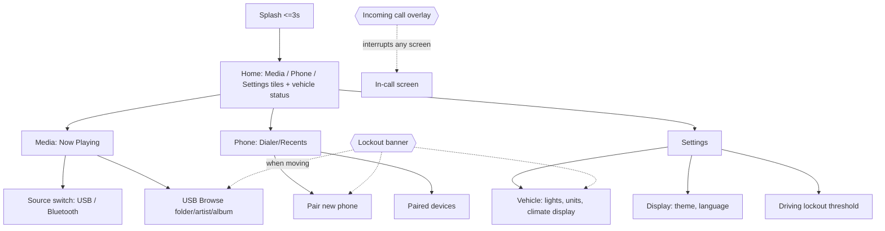

# One-O UX Journeys

Scope: MVP Must stories (US-005, 006, 010, 011, 013, 014, 015, 018, 019, 022). Display 10.25 in 1280x720 touch (D-07). Radio/camera out of MVP (D-02, D-03). Rules in `guidelines.md`. ASSUMPTION (confirm with customer) applies to all D-xx inputs.

## Navigation map
Persistent: status bar (top) and nav bar (bottom: Home, Back, Media, Phone, Settings). Home and Back reachable from every screen (US-005).

## Global elements

| Element | Content | Behaviour |
|---|---|---|
| Status bar | time, BT state, phone signal, alert icons | Updates <= 1 s (US-006) |
| Nav bar | Home, Back, Media, Phone, Settings | Always visible, never locked |
| Alert area | door-open, lamp warnings | Shown on Home and status bar (US-010) |
| Lockout state | "Locked while driving" label on disabled controls | Driven by speed > 8 km/h or speed unavailable (REQ-048..050) |

## Journeys

### J-01 Home and navigation (US-005, US-006)
| Step | User | System |
|---|---|---|
| 1 | Ignition on | Splash then Home <= 10 s cold |
| 2 | Taps Media/Phone/Settings tile | Screen visual response <= 100 ms |
| 3 | Taps Home/Back at any time | Returns without data loss |
Errors: tile target service down -> tile shows "Unavailable" with retry; app crash -> auto-recover to Home.

### J-02 View vehicle status (US-010)
| Step | User | System |
|---|---|---|
| 1 | Glances at Home status panel | Speed, gear, door/lamp warnings shown <= 200 ms after change |
| 2 | Signal lost | Value shows "--" (unavailable), never last value |
Allowed while driving: yes (read-only).

### J-03 Change vehicle setting (US-011)
| Step | User | System |
|---|---|---|
| 1 | Settings > Vehicle | List: lighting mode, units, climate display |
| 2 | Selects option | Control shows "Applying"; command sent via VehicleSignals |
| 3 | Vehicle confirms | UI shows actual vehicle state |
| 4 (fail) | No/negative confirmation | Control reverts; error toast + retry (REQ-028) |
Driving: editing locked; values readable.

### J-04 Play USB audio (US-013)
| Step | User | System |
|---|---|---|
| 1 | Plugs USB / taps Media > USB | Indexes; hot-plug detected, progress shown |
| 2 | Browses folder/artist/album | List (locked when moving: only top-level shortcuts, Now Playing, last-played) |
| 3 | Taps track | Plays, goes to Now Playing |
Errors: unsupported file skipped with notice; USB removed -> pause, return to source picker.

### J-05 Stream Bluetooth audio (US-014)
| Step | User | System |
|---|---|---|
| 1 | Source > Bluetooth (phone connected) | Now Playing with phone metadata |
| 2 | Play/pause/skip on HMI or on phone | State stays synchronised both ways |
Errors: no phone connected -> "Connect phone" action to J-07 (disabled when moving).

### J-06 Now playing, volume, source (US-015)
| Step | User | System |
|---|---|---|
| 1 | Opens Now Playing | Art, title, artist, progress, transport, volume, source |
| 2 | Changes volume | Immediate; persists across reboot |
| 3 | Switches source | Audible <= 2 s; previous source paused |
Driving: fully allowed (transport, volume, source); no text entry.

### J-07 Pair phone (US-018)
| Step | User | System |
|---|---|---|
| 1 | Phone > Pair new phone (parked) | Discoverable; device name + PIN-less pairing |
| 2 | Selects HMI on phone | Numeric comparison code shown on HMI |
| 3 | Taps Confirm | Paired; auto-connect; PBAP sync starts |
Rules: max 5 devices; at limit prompt to remove one. Locked when moving (banner explains). Timeout 60 s -> cancelled with retry.

### J-08 Hands-free call (US-019)
| Step | User | System |
|---|---|---|
| 1 | Incoming call | Overlay on any screen: caller, Answer, Reject; media ducks/pauses |
| 2 | Answer | In-call screen: mute, end, volume; audio routed to cabin |
| 3 | End | Media resumes; overlay dismissed |
| Outgoing | Recents tap-to-dial (large list <= 5 items while driving), voice not in MVP | Dial keypad locked when moving |
Answer/Reject/End never locked.

### J-09 Driving lockout (US-022)
| Step | User | System |
|---|---|---|
| 1 | Speed > 8 km/h (or unavailable) | Locked controls grey with lock icon; non-blocking banner |
| 2 | Taps locked control | Banner "Available when parked"; no action taken |
| 3 | Vehicle stops | Controls unlock after speed <= threshold for 1 s (hysteresis); in-progress locked flow is not resumed silently |
| 4 | Settings > Driving | Threshold adjustable only when parked |

| Function | Parked | Moving |
|---|---|---|
| Transport, volume, source, Home/Back | yes | yes |
| Answer/reject/end call | yes | yes |
| Text entry (keyboard, dial pad) | yes | no |
| Long list browsing (> 5 visible rows scroll) | yes | no |
| Pairing | yes | no |
| Settings editing | yes | no |
